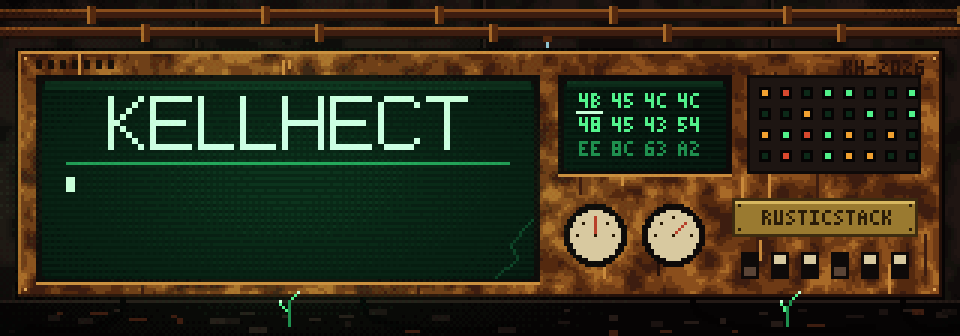
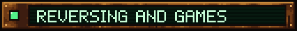
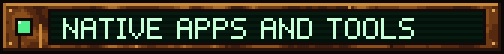
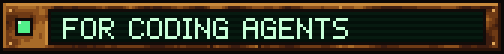
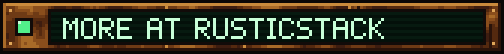

  

  I write native software, take games apart to see how they work, and build tools for coding agents. 
  Most of it lives at <a href="https://github.com/RusticStack"><b>RusticStack</b></a>.

  
  
  
  
  
  
  

 

<table>
  <tr>
    <td width="50%" valign="top">
      <h3><a href="https://github.com/KelpHect/kotor-remaster">kotor-remaster</a></h3>
      A clean-room runtime for <i>Knights of the Old Republic</i>, with the tooling used to reverse it. No game assets.  
      <code>C++</code> <code>what I'm working on now</code>
    </td>
    <td width="50%" valign="top">
      <h3><a href="https://github.com/RusticStack/hydra-engine">hydra-engine</a></h3>
      One Ghidra, many heads: a headless reverse-engineering engine that many agents and tools work in at the same time.  
      <code>Java</code> <code><a href="https://www.hydrare.dev">hydrare.dev</a></code>
    </td>
  </tr>
  <tr>
    <td valign="top">
      <h3><a href="https://github.com/RusticStack/Hydralysis">Hydralysis</a></h3>
      A small reverse-engineering toolkit for games you own, on top of Hydra Engine. One CLI and a short MCP server.  
      <code>Python</code>
    </td>
    <td valign="top">
      <h3><a href="https://github.com/RusticStack/Vaulter">Vaulter</a></h3>
      Tunes, patches and mods Borderlands 2, The Pre-Sequel and GOTY Enhanced. A native Windows 11 app.  
      <code>Rust</code>
    </td>
  </tr>
  <tr>
    <td valign="top">
      <h3><a href="https://github.com/KelpHect/Scribe">Scribe</a></h3>
      An addon manager for The Elder Scrolls Online, for people who are tired of fighting Minion.  
      <code>Rust</code>
    </td>
    <td valign="top">
      <h3><a href="https://github.com/KelpHect/cp2077-quiet-boot">cp2077-quiet-boot</a></h3>
      Cyberpunk 2077 straight to the main menu, with telemetry declined.  
      <code>Redscript</code>
    </td>
  </tr>
</table>

 

<table>
  <tr>
    <td width="50%" valign="top">
      <h3><a href="https://github.com/RusticStack/komorebi">komorebi</a></h3>
      A small, fast email client for Windows 10 and 11, with a local SQLite cache. No AI, no telemetry.  
      <code>Rust</code> <code><a href="https://komorebi.rusticstack.com">komorebi.rusticstack.com</a></code>
    </td>
    <td width="50%" valign="top">
      <h3><a href="https://github.com/RusticStack/dusage">dusage</a></h3>
      A fast parallel disk-usage scanner and safe pruner for Windows, with zero dependencies.  
      <code>Rust</code>
    </td>
  </tr>
  <tr>
    <td valign="top">
      <h3><a href="https://github.com/RusticStack/sentinel">sentinel</a></h3>
      A self-hosted CI engine built for speed: durable distributed runs, local-first caching and rootless isolation.  
      <code>Rust</code>
    </td>
    <td valign="top">
      <h3><a href="https://github.com/RusticStack/pico-reforged">pico-reforged</a></h3>
      Minimal CSS for semantic HTML: Pico CSS rewritten in plain modern CSS.  
      <code>CSS</code> <code><a href="https://pico.rusticstack.com">pico.rusticstack.com</a></code>
    </td>
  </tr>
</table>

 

<table>
  <tr>
    <td width="50%" valign="top">
      <h3><a href="https://github.com/RusticStack/agent-art">agent-art</a></h3>
      An MCP server that lets agents make game art and audio. It drew every picture on this page.  
      <code>JavaScript</code> <code>MCP</code>
    </td>
    <td width="50%" valign="top">
      <h3><a href="https://github.com/RusticStack/skills">skills</a></h3>
      Agent skills that prune what a repository doesn't need: stale comments and dead docs.  
      <code>Agent Skills</code>
    </td>
  </tr>
  <tr>
    <td valign="top">
      <h3><a href="https://github.com/KelpHect/re-expertise">re-expertise</a></h3>
      Evidence-first reverse-engineering skills for Claude Code, OpenCode and other agents.  
      <code>Agent Skills</code>
    </td>
    <td valign="top">
      <h3><a href="https://github.com/KelpHect/opencode-worktrees">opencode-worktrees</a></h3>
      Gives each OpenCode subagent its own branch and git worktree, so they can edit in parallel.  
      <code>TypeScript</code>
    </td>
  </tr>
</table>

 

  

